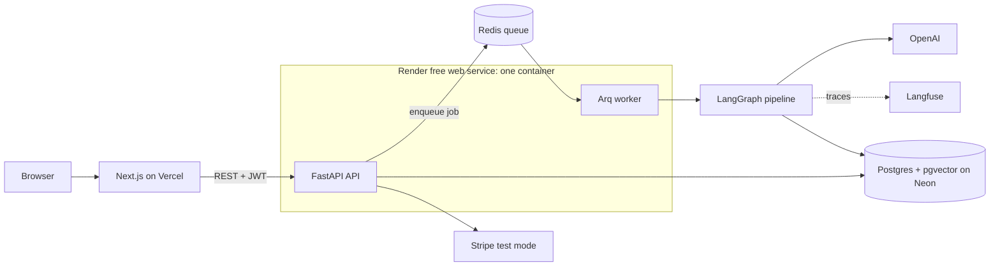
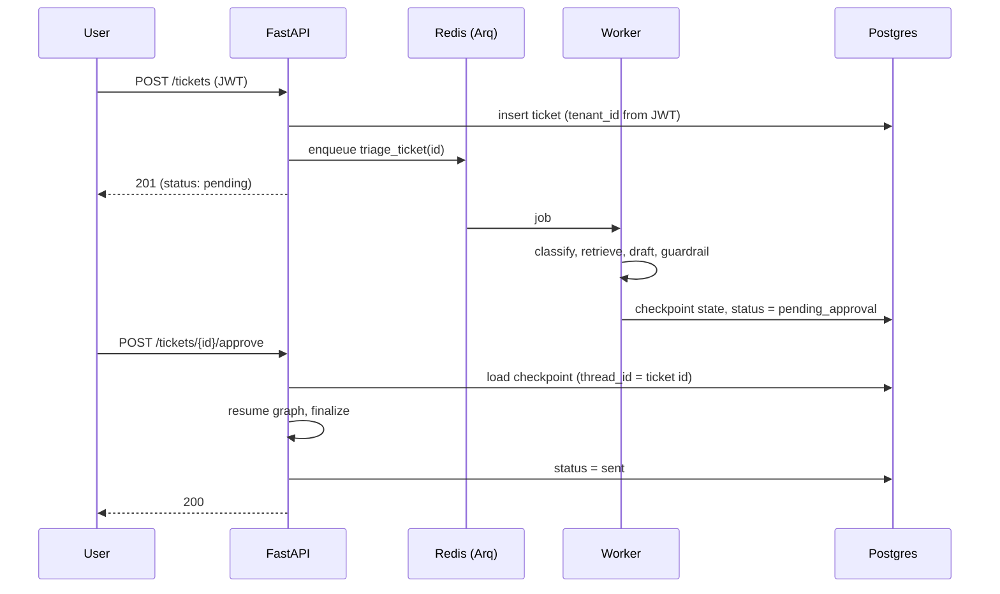

# SentinelDesk

**Async, multi-tenant AI support-ticket triage with durable human-in-the-loop approval.**

[](https://github.com/HillolPias/sentineldesk/actions/workflows/ci.yml)


**Live demo:** https://sentineldesk.vercel.app/login ·
_Hosted on free tiers: the first request after idle can take about a minute while the server wakes up._


## What it does

A support ticket comes in. A LangGraph pipeline classifies it, retrieves relevant help-center
articles (RAG), drafts a reply, and runs an independent LLM-as-judge guardrail. Then it **stops**.
Nothing is sent until a human reviews the draft and clicks Approve. The pause is durable: the
approval can happen minutes or days later, from a different process, and the pipeline resumes
exactly where it stopped.

## Highlights

- **Multi-tenant isolation, proven by tests.** Every query is scoped by the `tenant_id` carried in the
  signed JWT. Cross-tenant reads, approvals and billing are covered by tests; a missing filter fails CI.
- **Durable human-in-the-loop.** The graph state is checkpointed to Postgres (`thread_id` = ticket id),
  so an approval in the API process resumes a run that was paused by the worker process.
- **Async by design.** `POST /tickets` returns immediately; an Arq worker on Redis does the slow LLM work.
- **RAG on pgvector.** Knowledge-base embeddings live in the same Postgres as the application data.
- **Observability.** Every LLM call is traced in Langfuse, grouped by ticket.
- **Usage-based billing (Stripe test mode).** Processed tickets are metered in Postgres and invoiced
  idempotently (row locks plus Stripe idempotency keys, so a ticket is never billed twice).
- **Quality gates.** pytest suite against a real Postgres, Alembic migrations checked on an empty
  database, ruff, frontend lint and production build, Docker image build. All run on every PR.

## Architecture



### Ticket lifecycle



## Tech stack

| Layer    | Choice                                                                                        |
| -------- | --------------------------------------------------------------------------------------------- |
| Frontend | Next.js 16 (App Router), React 19, TypeScript, Tailwind CSS 4                                 |
| API      | FastAPI, async SQLAlchemy 2 + asyncpg, Alembic, Pydantic                                      |
| Queue    | Redis + Arq                                                                                   |
| AI       | LangGraph (Postgres checkpointer), OpenAI (`gpt-4o-mini`, `text-embedding-3-small`), Langfuse |
| Data     | PostgreSQL 18 + pgvector (Neon)                                                               |
| Billing  | Stripe (test mode)                                                                            |
| Quality  | pytest, ruff, GitHub Actions, Docker, uv                                                      |
| Hosting  | Vercel (web), Render (API + worker, Redis), Neon (Postgres)                                   |

## Reviewer tour (5 minutes)

| If you want to see...                 | Look at                                                                      |
| ------------------------------------- | ---------------------------------------------------------------------------- |
| Tenant isolation and its tests        | `apps/api/tests/test_tenant_isolation.py`, `apps/api/app/routers/tickets.py` |
| The AI pipeline and the durable pause | `apps/api/worker/pipeline/graph.py`, `apps/api/worker/tasks/triage_job.py`   |
| Approve / resume across processes     | `approve_ticket` in `apps/api/app/routers/tickets.py`                        |
| Idempotent billing                    | `apps/api/app/routers/billing.py`, `apps/api/tests/test_billing.py`          |
| CI gates                              | `.github/workflows/ci.yml`                                                   |
| Why things are built this way         | [`docs/decisions.md`](docs/decisions.md)                                     |

## Run it locally

Requirements: Docker, Python 3.14 with [uv](https://docs.astral.sh/uv/), Node 22, an OpenAI key,
a Langfuse project and a Stripe test key.

```bash
# infrastructure (Postgres with pgvector, Redis)
docker compose -f infra/docker-compose.yml up -d

# API
cd apps/api
cp .env.example .env            # then fill in the keys
uv sync
uv run alembic upgrade head
uv run python -m worker.pipeline.setup_checkpointer   # LangGraph's own tables
uv run python -m worker.pipeline.seed_kb              # embeds the demo knowledge base
uv run python -m run_api                              # terminal 1
uv run python -m worker.main                          # terminal 2

# Web (terminal 3)
cd apps/web
cp .env.example .env.local
npm ci && npm run dev
```

Open http://localhost:3000, create a workspace, submit a ticket, and approve the draft.

## Testing and CI

```bash
cd apps/api
uv run ruff check .
uv run pytest -v        # 31 tests; Stripe, Redis and the LLM graph are faked, Postgres is real
```

The suite runs against a real Postgres test database built from the Alembic migrations, so schema
bugs surface too. CI also upgrades an empty database and runs `alembic check` to catch models and
migrations drifting apart.

## Known limitations and roadmap

- **Free-tier hosting.** Cold starts (about a minute). The API and the worker share one container
  (separate entrypoints, ready to split). Redis is non-persistent: queued-but-unstarted jobs are lost on
  restart, while paused approvals survive because their state lives in Postgres.
- **Rate limiting is not implemented yet**, so a public deployment needs a spend cap on the LLM key.
  Planned: per-tenant limits and a request-size cap.
- **Tenant isolation is enforced in application queries (and tested)**, not yet by Postgres row-level
  security.
- The UI **polls every 4 seconds**; SSE or WebSockets would be the next step.
- The JWT is kept in `localStorage` (simple, but exposed to XSS) and there are no refresh tokens.
- Billing is simulated usage-based billing (counted in Postgres, invoiced via Stripe test mode), not
  Stripe metered subscriptions.
- The knowledge base is a small fictional dataset.
- Next: an offline evaluation harness for the triage pipeline, OpenTelemetry, load-test results.

## Project structure

```
apps/
  api/      FastAPI app, Arq worker, LangGraph pipeline, Alembic migrations, tests, Dockerfile
  web/      Next.js frontend
infra/      docker-compose for local Postgres (pgvector) and Redis
docs/       design decisions and assets
.github/    CI workflow, PR template, Dependabot
```

## License

MIT. See [LICENSE](LICENSE).
